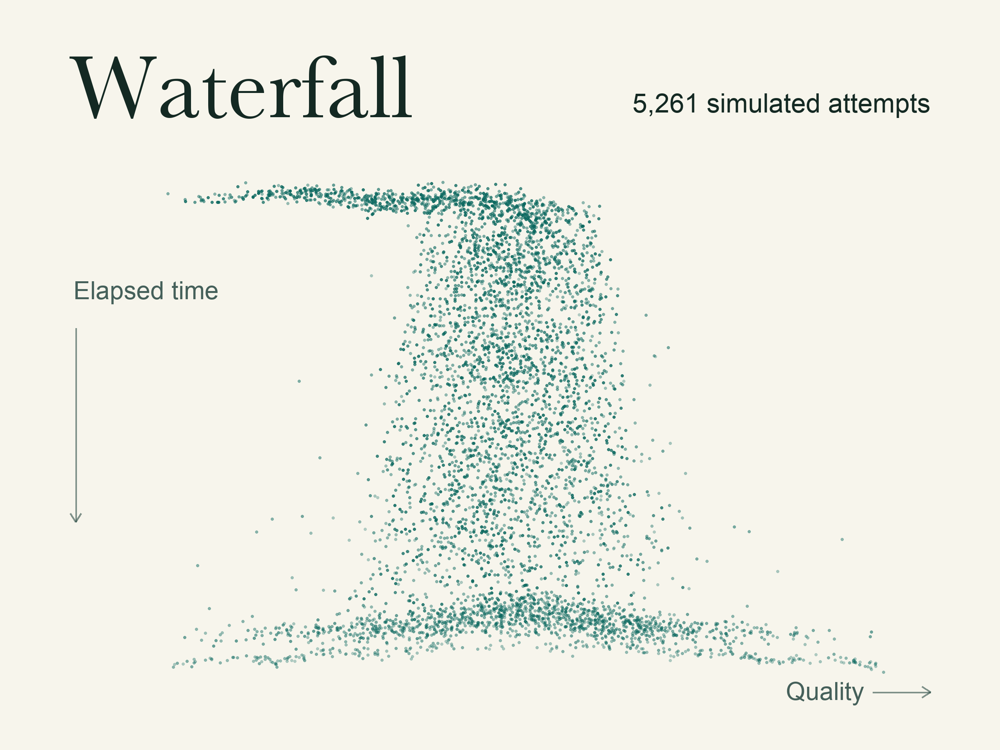

# Waterfall — A run-level benchmark for AI agents

**Proposal v0.1 · 2026-11-19**

**Suggested citation** — *Waterfall: A Run-Level Benchmark for AI Agents*. Proposal v0.1, 2026-11-19.

## 1. Purpose

Waterfall is a method for comparing agent configurations on recurring work. A team defines a versioned suite of real tasks, runs each configuration against the same cases, and plots each attempt as a point. The history shows how quality, elapsed time, and cost change as the team tries new models, reasoning settings, or harnesses.

Teams can use their own task store, runner, scoring logic, and charting tools. The convention to share is the meaning of a run, the conditions that make runs comparable, and how results appear in the chart. Each team supplies the work and acceptance criteria that matter to it.

## 2. The Waterfall scatter plot

The point-cloud study uses synthetic attempts arranged to illustrate the waterfall shape. When comparing actual configurations, the observed run coordinates determine the shape.

- **Horizontal position** is output quality under a named rubric. Higher quality appears to the right. A binary rubric can use two columns, fail and pass. Use a numeric scale when the rubric supports meaningful partial credit.
- **Vertical position** is observed elapsed time. Zero belongs at the top and longer runs fall lower. Measure from when the agent begins the task until the attempt terminates, including tool waits, automatic retries, and any review gate inside the workflow. Record benchmark-only grading time separately.
- **One mark represents one attempt.** Use equal-sized markers, with color and shape identifying configurations. If observations overlap, expose the individual records or the overlap count. Plot attempts without a quality score in an unscored lane at their measured time. Put attempts with missing time in a visible status count alongside the chart.
- **Reference lines** can show a quality threshold and a time target. In the model comparison, a quality score of at least 80 and an elapsed time of at most 60 seconds meet both numeric targets. A mandatory check can still reject a high-scoring run, so always retain the acceptance verdict.

An optional third metric can appear on hover, as a color scale, or in a separate panel. A 3D view can use cost in USD as the z-axis. For higher-dimensional comparisons, filter or facet by task family, reasoning setting, or budget, and keep the same x and y scales. Choosing 2D as the default makes older and newer charts easier to compare and avoids hiding observations behind one another.

In the web demo, each dot is inspectable. Readers can select a model and an inclusive range of run dates to see the matching attempts together, with totals for the period and a breakdown by reasoning setting. The time target controls how many accepted attempts count as on time. The source is a standalone browser page that teams can adapt to records from their own runner. [Private demo](https://waterfall-benchmark-demo.pluckygeode8.chatgpt.site), [web demo source](web-demo/dist/index.html)

## 3. The records to maintain

| Record | Minimum information |
|---|---|
| Task case | Stable case ID and version, suite version, task family, instruction, reproducible starting state, allowed tools and permissions, resource limits, and acceptance criteria. |
| Configuration | Configuration ID, provider and model version, provider-native reasoning setting, harness and prompt versions, and any tool or retry-policy changes. |
| Attempt | Unique attempt ID linked to a case and configuration, start timestamp, trial index, elapsed seconds or missing value, terminal status, quality score or missing value, verdict, rubric or verifier version, and artifact or trace reference when available. |
| Optional metrics | Execution cost with currency and accounting boundary, tokens by type, peak input tokens per request, human review time, and verified checkpoints. |

Append new attempts and preserve historical measurements. Record a new suite version when its case set or shared evaluation protocol changes. When the rubric changes, regrade saved outputs where possible and retain both grades under their respective versions. Otherwise report historical results by version and use a fresh paired run for the comparison. Different rubrics can share a display scale while measuring different things, so facet by rubric unless a common interpretation has been validated.

**Status and verdict record different facts.** Status describes how execution ended. Verdict describes whether the outcome was accepted. Count an agent timeout or agent error as an unsuccessful attempt under the configured budget, even when the output cannot be scored. For an independent host or evaluator failure, preserve the attempt and mark it invalid for the controlled comparison. Report invalid counts and rerun the corresponding case. If that infrastructure is part of the deployment being evaluated, include its failures in a separately labeled end-to-end reliability figure. Unknown scores, times, or costs stay missing.

## 4. How to evaluate a model change

1. **Choose the decision before running.** Define the relevant case families, mandatory checks, and acceptable changes in reliability, latency, and spend. For regression-test generation, a mandatory check could require a test to fail for the expected reason on the buggy revision and pass on the fixed revision. For subjective output, version the rubric and verify judge agreement against human-reviewed examples.
2. **Compare paired cases.** Use the same case versions, starting state, budgets, rubric, and verification policy. Where practical, run each configuration multiple times per case and interleave configurations to reduce time-of-run effects. A different reasoning setting is a separate configuration. When testing a model-only change, hold the rest fixed. If the adapter or prompt also changes, report a configuration comparison.
3. **Read the points beside the counts.** Report valid and invalid attempts, acceptance, a latency summary, and cost per accepted outcome when spend is known. For matched valid attempts, divide total execution cost, including failed attempts and their retries, by accepted outcomes. If there are zero accepted outcomes or incomplete spend, label the ratio unavailable. Report invalid-run spend separately when known. If cases have uneven repeat counts, report paired case-level results so frequently repeated cases cannot silently determine the conclusion.
4. **Start with a pilot and confirm before switching.** A few runs at different reasoning settings can identify promising configurations and obvious trade-offs. Test the promising settings on the representative suite before deciding. Report results by important task family and show the spread or uncertainty when the data supports it. Inspect paired traces for individual regressions if your harness captures them.

## 5. Reading the example

The model comparison uses 15 **synthetic** attempts on one case with one rubric. Each configuration has one attempt on each of five illustrative dates between November 15 and 23, 2026. The acceptance threshold is 80/100, the default time target is 60 seconds, and the hard timeout is 100 seconds. The time target is separate from the acceptance verdict for this example.

| Configuration | Accepted | Accepted within 60 s | Execution spend | Cost per acceptance |
|---|---:|---:|---:|---:|
| Incumbent · medium | 4/5 | 2/5 | $3.50 | $0.88 |
| Candidate · medium | 3/5 | 3/5 | $2.20 | $0.73 |
| Candidate · high | 5/5 | 0/5 | $6.00 | $1.20 |

The medium candidate has three fast acceptances and one timeout. The high setting accepts all five attempts and misses the time target every time. A team that values turnaround would investigate the medium candidate’s missed cases. A team that values acceptance above speed would test whether the high setting’s advantage holds over more cases. Those are different decisions visible in the same chart.

The example can be reproduced from the following tuples `(quality, elapsed seconds, execution cost in USD)`.

| Configuration | Attempts |
|---|---|
| Incumbent · medium | `(74, 58, 0.59)`, `(81, 52, 0.63)`, `(84, 57, 0.71)`, `(88, 65, 0.77)`, `(92, 61, 0.80)` |
| Candidate · medium | `(65, 36, 0.32)`, `(82, 32, 0.41)`, `(89, 39, 0.48)`, `(95, 47, 0.58)`, `(null, 100, 0.41)` |
| Candidate · high | `(81, 73, 1.05)`, `(88, 79, 1.17)`, `(93, 70, 1.18)`, `(96, 86, 1.25)`, `(99, 95, 1.35)` |

## 6. Prior art

Artificial Analysis defines comparable benchmark tasks and reports cost and runtime per agent variant. *AI Agents That Matter* motivates evaluating cost alongside accuracy. HAL compares models, scaffolds, and benchmarks. Waterfall applies those ideas to a team’s growing collection of repeated, paired run results. [Artificial Analysis methodology](https://artificialanalysis.ai/methodology/coding-agents-benchmarking), [AI Agents That Matter](https://arxiv.org/abs/2407.01502), [Holistic Agent Leaderboard](https://arxiv.org/abs/2510.11977)

Harbor already defines task and trajectory formats. AgentQuest measures progress and repeated actions within a run, and AgentLens combines trajectory comparison with regression evaluation. AWS provides an open-source coding-agent benchmark for cost, quality, and duration. These are examples of components or approaches teams can reuse when implementing Waterfall. [Harbor](https://docs.harborframework.com/), [AgentQuest](https://aclanthology.org/2024.naacl-demo.19/), [AgentLens](https://arxiv.org/abs/2607.06624), [AWS sample](https://github.com/aws-samples/sample-agent-cost-bench)

The companion [agent skill](waterfall-benchmark/SKILL.md) gives agents a practical procedure for applying this proposal to an existing harness.
